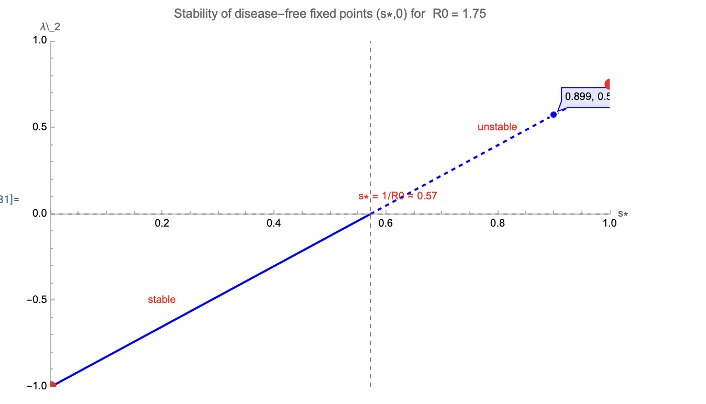
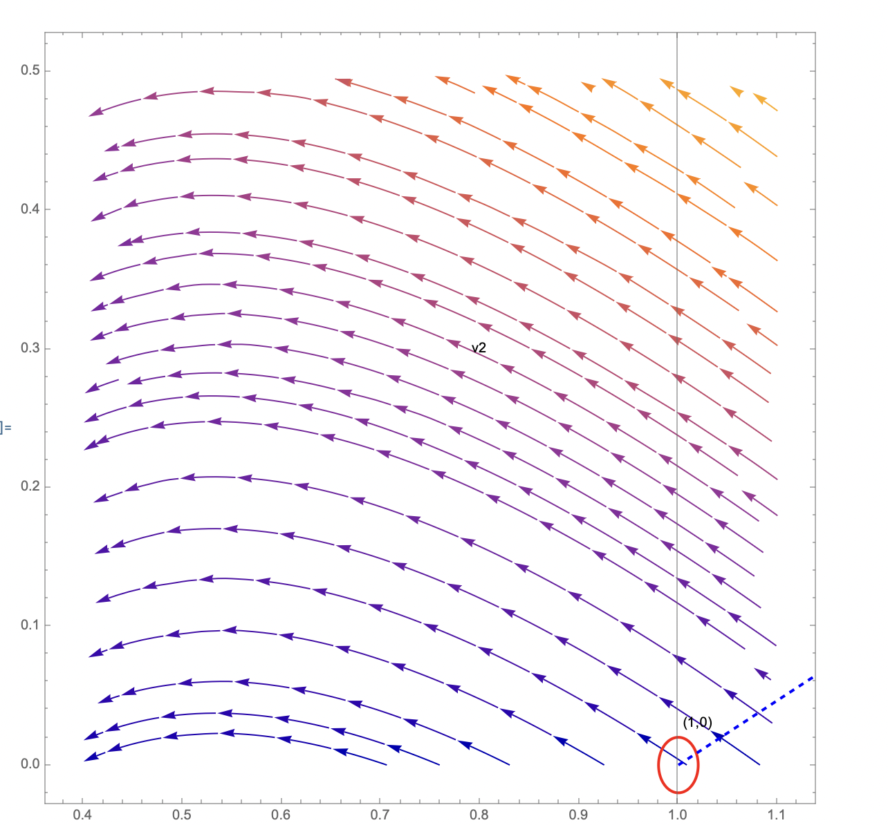
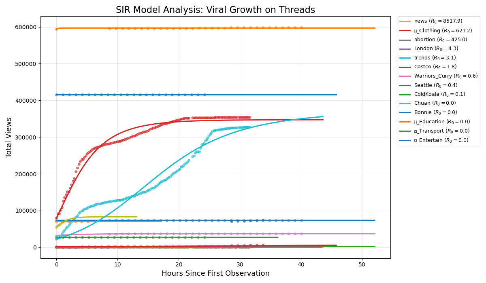
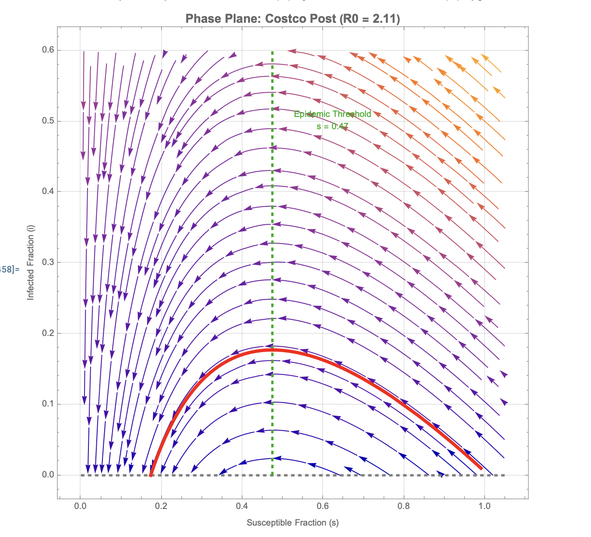

# Information Diffusion on Threads: An Application of the SIR Model

Math 3440 (Nonlinear Systems) research project, Seattle University, Fall 2025
Kevin Lin

Memes, slang and viral posts spread online a lot like a disease spreads through a population. In this project I treat a Threads post as an "outbreak": I collect real view-count data with a Selenium scraper, fit the classical SIR model to it, and use stability analysis and phase portraits to explain when a post goes viral and when it dies out.

Full paper: [`paper/MATH3440_Threads_Project.pdf`](paper/MATH3440_Threads_Project.pdf)

## Model

Users are split into three groups:

| Group | Meaning on Threads |
|---|---|
| **S** (susceptible) | users in the feed pool who have not seen the post yet |
| **I** (infected) | users who are viewing, liking or sharing it right now |
| **R** (recovered) | users who already saw it and moved on |

$$\frac{dS}{dt} = -\frac{\beta S I}{N}, \qquad \frac{dI}{dt} = \frac{\beta S I}{N} - \gamma I, \qquad \frac{dR}{dt} = \gamma I$$

We only observe cumulative views, so the model is fit through $V(t) = N - S(t)$. The basic reproduction number $R_0 = \beta / \gamma$ tells us how many new viewers one active viewer creates at the start.

## What I did

**1. Data collection.** I wrote a Selenium scraper (`src/threads_tracker.py`) that opens each tracked post about every 10 minutes and saves the timestamp and view count to a CSV. Then `src/prepare_data.py` merges the raw files, converts strings like `1.2K` into numbers, and computes hours since the first observation.

**2. Stability analysis.** I reduced the system to fractions $(s, i)$ and found that every point $(s^*, 0)$ on the line $i = 0$ is a fixed point. The Jacobian there has eigenvalues

$$\lambda_1 = 0, \qquad \lambda_2 = \gamma (R_0 s^* - 1)$$

so the starting state $(1, 0)$ is unstable exactly when $R_0 > 1$. That is the viral threshold, and it acts like a transcritical bifurcation at $R_0 = 1$.



**3. Phase plane.** The nullcline $s = \gamma / \beta$ splits the plane: to the right, active spreaders grow; to the left, they shrink. Dividing the two equations gives the closed-form phase curves

$$i + s - \frac{\gamma}{\beta} \ln s = C$$



**4. Fitting to real data.** `src/fit_sir.py` estimates $\beta$ and $\gamma$ for each post with nonlinear least squares (`scipy.optimize.curve_fit` on the ODE solved with `odeint`).



**5. Costco post.** This post had one of the cleanest fits, so I studied it in detail: $\beta = 0.38$, $\gamma = 0.18$, $R_0 \approx 2.1$. Its trajectory rises while $s > \gamma/\beta \approx 0.47$, turns over once it crosses that line, and then slowly falls back to $i = 0$.



## What I learned

- Posts with $R_0$ well above 1 show the S-shaped curve you expect from an epidemic: fast growth, then saturation.
- Posts that were already flat when tracking started give unreliable estimates. For these, $\gamma$ hits the lower bound in the fit, so $R_0$ comes out extremely large or close to 0. The model fits the curve, but the parameters cannot really be identified from that data.
- The SIR model assumes a well-mixed audience and constant $\beta$ and $\gamma$. A real feed has algorithmic boosting and a spreading speed that changes over time. Next steps could be a time-varying $\beta(t)$, a network version of SIR, or adding uncertainty estimates for the parameters.

## Repository structure

```
├── src/
│   ├── threads_tracker.py   # Selenium scraper for view counts
│   ├── prepare_data.py      # merge and clean raw CSVs
│   └── fit_sir.py           # fit SIR, compute R0, plot
├── mathematica/
│   └── sir_phase_plane.wl   # eigenvalue plot and phase portraits
├── figures/                 # figures used in the paper
├── paper/                   # final report (PDF)
└── data/                    # put raw CSVs here (not included)
```

## How to run

```bash
pip install -r requirements.txt
python src/threads_tracker.py   # collect data (needs Chrome and a logged-in Threads profile)
python src/prepare_data.py      # build data/threads_SIR_ready.csv
python src/fit_sir.py           # fit the model and save the plot
```

The post URLs in `threads_tracker.py` are placeholders. The raw data is not included because it comes from other users' public posts. The scraper was written for a one-time class project; please follow Threads' terms of use if you run it.

## Tools

Python (Selenium, pandas, NumPy, SciPy, Matplotlib), Mathematica, LaTeX

## References

- Kermack, W. O., and A. G. McKendrick (1927). A Contribution to the Mathematical Theory of Epidemics. *Proc. Royal Society A*, 115, 700–721.
- Strogatz, S. H. (2024). *Nonlinear Dynamics and Chaos*, 3rd ed. CRC Press.
- Jin, F., et al. (2013). Epidemiological Modeling of News and Rumors on Twitter. *SNA-KDD '13*.
- Pastor-Satorras, R., et al. (2015). Epidemic Processes in Complex Networks. *Reviews of Modern Physics*, 87, 925–979.
